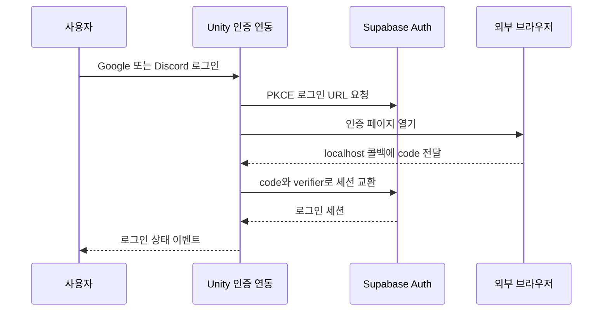
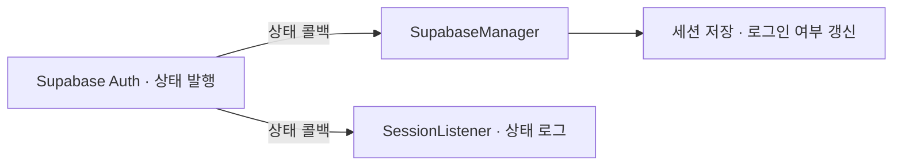

# Supabase 인증과 세션 관리

**담당자:** 최성원 — Unity 인증 연동, 세션 복원, Google·Discord 로그인 흐름 구성

## 코드



**SupabaseManager · SignInWithEmailPassword:** 앱 시작 시 세션을 복원하고 이메일 인증 요청을 처리합니다. **SessionListener:** 인증 상태를 구독합니다. 아래에서는 상태 알림을 하나의 이벤트로 통합했습니다.

SDK의 Observer형 리스너 연결입니다. 원본은 로그인 상태·세션 저장을 갱신하며, 아래 코드의 `LoginStateChanged`는 설명용으로 통합한 이벤트입니다.



```csharp
// SupabaseManager와 SignInWithEmailPassword의 핵심 흐름을 통합한 발췌
private Client client;
private readonly UnitySession persistence = new();
public event Action<bool> LoginStateChanged;

// 클라이언트 생성, 세션 저장소 연결, 저장된 로그인 복원
public async Task InitializeAsync(string url, string publicKey)
{
    client = new Client(url, publicKey,
        new SupabaseOptions { AutoRefreshToken = true });
    client.Auth.Options.AllowUnconfirmedUserSessions = false;
    // SDK의 세션 저장·복원에 같은 저장소를 연결한다.
    client.Auth.SetPersistence(persistence);
    client.Auth.AddStateChangedListener(OnAuthStateChanged);
    client.Auth.LoadSession();
    await client.InitializeAsync();
}

// 로그인·로그아웃·토큰 갱신을 UI가 구독할 수 있는 상태로 전달
private void OnAuthStateChanged(
    IGotrueClient<User, Session> sender, Constants.AuthState state)
{
    if (state == Constants.AuthState.SignedIn && sender.CurrentSession != null)
        persistence.SaveSession(sender.CurrentSession);

    // 회원가입 성공과 실제 로그인 상태는 구분한다.
    bool loggedIn = state != Constants.AuthState.PasswordRecovery
        && state != Constants.AuthState.SignedOut
        && state != Constants.AuthState.Shutdown
        && sender.CurrentSession?.AccessToken != null
        && !sender.CurrentSession.Expired();
    LoginStateChanged?.Invoke(loggedIn);
}

// 회원가입 요청. 반환값은 가입 성공 여부가 아니라 즉시 로그인 여부
public async Task<bool> SignUpAsync(
    string email, string password, string confirmationUrl)
{
    var session = await client.Auth.SignUp(email, password,
        new SignUpOptions { RedirectTo = confirmationUrl });
    // false이면 이메일 확인 안내를 표시하고 로그인을 기다린다.
    return session?.AccessToken != null;
}

// 이메일과 비밀번호로 로그인 세션 발급
public Task<Session> SignInAsync(string email, string password)
    => client.Auth.SignIn(email, password);

// 비밀번호 재설정 메일 요청
public Task<bool> SendPasswordResetAsync(string email)
    => client.Auth.ResetPasswordForEmail(email);

// 인증된 세션에서 새 비밀번호 적용
public async Task ChangePasswordAsync(string password)
{
    if (client.Auth.CurrentSession == null)
        throw new InvalidOperationException("로그인 또는 복구 세션이 필요합니다.");

    await client.Auth.Update(new UserAttributes { Password = password });
}

// 현재 로그인 세션 종료
public async Task SignOutAsync() => await client.Auth.SignOut();

// 상태 구독과 SDK의 토큰 갱신 작업 정리
public void Shutdown()
{
    client.Auth.RemoveStateChangedListener(OnAuthStateChanged);
    client.Auth.Shutdown();
}
```

**OAuthManager:** 외부 브라우저의 Google·Discord 인증 결과를 PC 앱으로 받아 동일한 Supabase 세션으로 연결합니다.

```csharp
// OAuthManager: PC의 로컬 콜백을 사용하며 provider만 바꿔 재사용한다.
// 호출 예: SignInWithProviderAsync(Constants.Provider.Google, port)
//          SignInWithProviderAsync(Constants.Provider.Discord, port)
// provider별 로그인 URL 생성 → 콜백 수신 → PKCE 코드 교환
public async Task<Session> SignInWithProviderAsync(
    Constants.Provider provider, int port)
{
    string redirect = $"http://localhost:{port}/callback/";
    using var listener = new System.Net.HttpListener();
    listener.Prefixes.Add(redirect);
    listener.Start();

    var oauth = await client.Auth.SignIn(provider, new SignInOptions
    {
        RedirectTo = redirect,
        FlowType = Constants.OAuthFlowType.PKCE
    });
    if (oauth?.Uri == null)
        throw new InvalidOperationException("OAuth URL을 생성할 수 없습니다.");

    // 브라우저를 열기 전에 콜백 수신을 준비해 빠른 인증 완료도 놓치지 않는다.
    var callbackTask = listener.GetContextAsync();
    Application.OpenURL(oauth.Uri.ToString());
    if (await Task.WhenAny(callbackTask, Task.Delay(TimeSpan.FromMinutes(3)))
        != callbackTask)
        throw new TimeoutException("로그인 대기 시간이 초과되었습니다.");

    var context = await callbackTask;
    var query = System.Web.HttpUtility.ParseQueryString(context.Request.Url.Query);
    // 브라우저 응답은 닫고, 로그인 세션 발급은 아래의 코드 교환으로 마무리한다.
    context.Response.StatusCode = 200;
    context.Response.Close();

    string code = query["code"];
    if (string.IsNullOrEmpty(code))
        throw new InvalidOperationException("인증 코드가 없습니다.");

    // 요청 시 생성된 verifier와 callback의 code를 함께 사용한다.
    var session = await client.Auth.ExchangeCodeForSession(oauth.PKCEVerifier, code);
    return session ?? throw new InvalidOperationException("세션 교환에 실패했습니다.");
}
```

## 생략 및 재구성한 내용

- 원본: `OAuthManager.cs`, `SessionListener.cs`, `SignInWithEmailPassword.cs`, `SupabaseManager.cs` (`Assets/App/com/example/`). 기준 커밋: `66882730c36e4c3f4e7d59f019a835ea749f39b8`.
- 여러 MonoBehaviour의 호출을 한 흐름으로 재구성한 **설명용 발췌**입니다. SDK 예제 기반 초기화와 프로젝트에서 추가한 인증 연동을 함께 보여주며, Supabase SDK 자체를 구현한 것은 아닙니다.
- SDK·Unity·`UnitySession`은 원본 의존성입니다. using, 클래스 선언, UI 입력·팝업, 닉네임·계정 삭제, 연결 감시와 오프라인 복원은 생략했습니다. SDK 형식과 설정 없이 단독 실행되지 않습니다.
