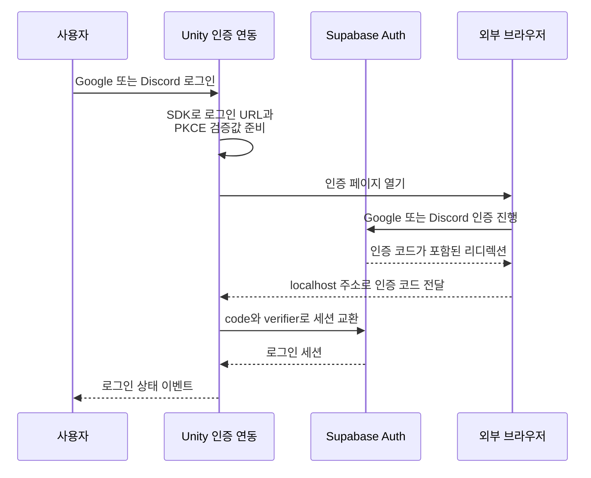
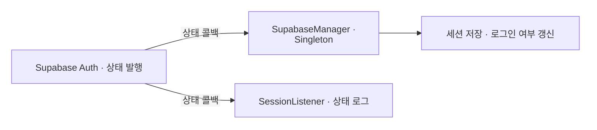

# Supabase 인증과 세션 관리

담당자 최성원 — Unity 인증 연동, 세션 복원, Google·Discord 로그인 흐름 구성

플레이어는 게임에서 Google이나 Discord 로그인을 시작하고, 브라우저에서 인증을 마치면 게임으로 돌아와 온라인 기능을 사용할 수 있습니다. 게임을 다시 실행할 때는 저장한 세션을 불러오고, 여러 씬에서 같은 인증 클라이언트를 사용합니다.

[이메일 로그인과 세션 복원](#이메일-로그인과-세션-복원) · [브라우저 인증](#브라우저-인증-결과를-게임으로-받기) · [원본 코드와 예시 범위](#원본-코드와-예시-범위)

## 코드



### 이메일 로그인과 세션 복원

`SupabaseManager`는 시작할 때 `UnitySession`을 저장소로 연결하고, 로그인·로그아웃·토큰 갱신에 맞춰 로그인 상태를 갱신합니다. 예를 들어 이메일 확인이 필요한 회원가입에서는 인증 메일 안내를 보여주고, 로그인 세션이 생기면 온라인 메뉴에서 사용할 상태를 갱신합니다. `LoginStateChanged`는 이 상태 전달을 설명하기 위해 예시에 추가한 이벤트입니다.



```csharp
// SupabaseManager와 SignInWithEmailPassword의 핵심 흐름을 통합한 발췌
public static SupabaseManager Instance;

// 씬 전환 시 인증 클라이언트가 중복 생성되지 않게 한 인스턴스를 유지
private void Awake()
{
    if (Instance != null && Instance != this)
    {
        Destroy(gameObject);
        return;
    }
    Instance = this;
    DontDestroyOnLoad(gameObject);
}

private Client client;
private readonly UnitySession persistence = new();
public event Action<bool> LoginStateChanged;

// 클라이언트 생성, 세션 저장소 연결, 저장된 로그인 복원
public async Task InitializeAsync(string url, string publicKey)
{
    client = new Client(url, publicKey,
        new SupabaseOptions { AutoRefreshToken = true });
    client.Auth.Options.AllowUnconfirmedUserSessions = false;
    // SDK의 세션 저장·복원에 같은 저장소를 연결한다.
    client.Auth.SetPersistence(persistence);
    client.Auth.AddStateChangedListener(OnAuthStateChanged);
    client.Auth.LoadSession();
    await client.InitializeAsync();
}

private bool isLoggedIn;

// 로그인·로그아웃·토큰 갱신을 UI가 구독할 수 있는 상태로 전달
private void OnAuthStateChanged(
    IGotrueClient<User, Session> sender, Constants.AuthState state)
{
    if (state == Constants.AuthState.SignedIn && sender.CurrentSession != null)
        persistence.SaveSession(sender.CurrentSession);

    isLoggedIn = state switch
    {
        Constants.AuthState.SignedIn or Constants.AuthState.TokenRefreshed
            or Constants.AuthState.UserUpdated => sender.CurrentSession?.AccessToken != null
                && !sender.CurrentSession.Expired(),
        Constants.AuthState.PasswordRecovery or Constants.AuthState.SignedOut
            or Constants.AuthState.Shutdown => false,
        _ => isLoggedIn
    };
    LoginStateChanged?.Invoke(isLoggedIn);
}

// 회원가입 요청. 반환값은 가입 성공 여부가 아니라 즉시 로그인 여부
public async Task<bool> SignUpAsync(
    string email, string password, string confirmationUrl)
{
    var session = await client.Auth.SignUp(email, password,
        new SignUpOptions { RedirectTo = confirmationUrl });
    // false이면 이메일 확인 안내를 표시하고 로그인을 기다린다.
    return session?.AccessToken != null;
}

// 이메일과 비밀번호로 로그인 세션 발급
public Task<Session> SignInAsync(string email, string password)
    => client.Auth.SignIn(email, password);

// 비밀번호 재설정 메일 요청
public Task<bool> SendPasswordResetAsync(string email)
    => client.Auth.ResetPasswordForEmail(email);

// 인증된 세션에서 새 비밀번호 적용
public async Task ChangePasswordAsync(string password)
{
    if (client.Auth.CurrentSession == null)
        throw new InvalidOperationException("로그인 또는 복구 세션이 필요합니다.");

    await client.Auth.Update(new UserAttributes { Password = password });
}

// 현재 로그인 세션 종료
public async Task SignOutAsync() => await client.Auth.SignOut();

// 상태 구독과 SDK의 토큰 갱신 작업 정리
public void Shutdown()
{
    client.Auth.RemoveStateChangedListener(OnAuthStateChanged);
    client.Auth.Shutdown();
}
```

### 브라우저 인증 결과를 게임으로 받기

`OAuthManager`는 PC에서 게임이 열어 둔 `localhost` 주소로 브라우저의 인증 코드를 받습니다. Supabase SDK에 인증 코드와 로그인 시작 때 준비한 PKCE 검증값을 함께 보내면 게임의 로그인 세션이 발급됩니다. Google과 Discord 모두 이 경로를 사용합니다. [Supabase PKCE 문서](https://supabase.com/docs/guides/auth/sessions/pkce-flow)

```csharp
// OAuthManager: PC의 로컬 콜백을 사용하며 provider만 바꿔 재사용한다.
// 호출 예: SignInWithProviderAsync(Constants.Provider.Google, port)
//          SignInWithProviderAsync(Constants.Provider.Discord, port)
// provider별 로그인 URL 생성 → 콜백 수신 → PKCE 코드 교환
public async Task<Session> SignInWithProviderAsync(
    Constants.Provider provider, int port)
{
    string redirect = $"http://localhost:{port}/callback/";
    using var listener = new System.Net.HttpListener();
    listener.Prefixes.Add(redirect);
    listener.Start();

    var oauth = await client.Auth.SignIn(provider, new SignInOptions
    {
        RedirectTo = redirect,
        FlowType = Constants.OAuthFlowType.PKCE
    });
    if (oauth?.Uri == null)
        throw new InvalidOperationException("OAuth URL을 생성할 수 없습니다.");

    // 브라우저를 열기 전에 콜백 수신을 준비해 빠른 인증 완료도 놓치지 않는다.
    var callbackTask = listener.GetContextAsync();
    Application.OpenURL(oauth.Uri.ToString());
    if (await Task.WhenAny(callbackTask, Task.Delay(TimeSpan.FromMinutes(3)))
        != callbackTask)
        throw new TimeoutException("로그인 대기 시간이 초과되었습니다.");

    var context = await callbackTask;
    var query = System.Web.HttpUtility.ParseQueryString(context.Request.Url.Query);
    // 브라우저 응답은 닫고, 로그인 세션 발급은 아래의 코드 교환으로 마무리한다.
    context.Response.StatusCode = 200;
    context.Response.Close();

    string code = query["code"];
    if (string.IsNullOrEmpty(code))
        throw new InvalidOperationException("인증 코드가 없습니다.");

    // 요청 시 생성된 verifier와 callback의 code를 함께 사용한다.
    var session = await client.Auth.ExchangeCodeForSession(oauth.PKCEVerifier, code);
    return session ?? throw new InvalidOperationException("세션 교환에 실패했습니다.");
}
```

## 원본 코드와 예시 범위

- 기준 커밋은 [`6688273`](https://github.com/1Seong/Capstone2/commit/66882730c36e4c3f4e7d59f019a835ea749f39b8)입니다. 앱 초기화와 이메일 인증은 [SupabaseManager.Start](https://github.com/1Seong/Capstone2/blob/66882730c36e4c3f4e7d59f019a835ea749f39b8/Assets/App/com/example/SupabaseManager.cs#L49), [SignInWithEmailPassword](https://github.com/1Seong/Capstone2/blob/66882730c36e4c3f4e7d59f019a835ea749f39b8/Assets/App/com/example/SignInWithEmailPassword.cs), 소셜 로그인은 [OAuthManager.SignInWithProvider](https://github.com/1Seong/Capstone2/blob/66882730c36e4c3f4e7d59f019a835ea749f39b8/Assets/App/com/example/OAuthManager.cs#L53)에서 확인할 수 있습니다.
- 여러 컴포넌트의 호출을 두 흐름으로 재구성했습니다. 세션 발급, 코드 교환과 토큰 갱신은 Supabase SDK가 처리하며, 게임 코드는 세션 저장소, 브라우저 콜백, UI 상태를 연결합니다.
- PC 콜백 예시는 포트 선택, 인증 완료 페이지로의 리디렉션, UI 오류 처리를 간소화했습니다. 시작 시 연결 감시와 오프라인 분기는 원본 `SupabaseManager`에 있습니다.
