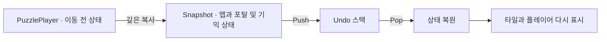

# 퍼즐 이동·Undo와 인버터

**담당자:** 최성원 — 이동·타일 상태 처리, 기믹 연동, 게임 상태 복원

## 코드

**Memento 방식의 Undo:** 변경 전 값의 사본을 스택에 보관합니다. 명령 객체를 실행·취소하는 Command 패턴이 아니라 상태 복원이며, Originator·보관 역할은 PuzzlePlayer 안에 있습니다.



**PuzzlePlayer:** 이동과 기믹을 처리하고 클리어를 판정합니다. **TileHelper:** 타일의 색칠·반전 상태를 변환합니다. **PuzzleTile:** 상태를 화면에 표시합니다.

```csharp
// PuzzlePlayer.MovePlayer / ApplyItem에서 기본 이동과 포탈 처리만 발췌
// 한 번의 입력을 이동·색칠·포탈·클리어 판정 순서로 처리
private async UniTask MoveAndPaintAsync(Vector3Int direction)
{
    if (isMoving || isCleared) return;
    Vector3Int next = playerPosition + direction;
    if (!IsOnSurface(next)) return;
    char tile = map[next.x, next.y, next.z];
    if (tile == (char)TileType.Empty || TileHelper.IsPainted(tile)) return;

    // 이동 연출이 끝날 때까지 추가 입력이 같은 상태를 동시에 바꾸지 못하게 한다.
    isMoving = true;
    try
    {
        SaveUndoState();
        await playerModel.DOMove(next, playerMoveDuration)
            .AsyncWaitForCompletion().AsUniTask();
        playerPosition = next;

        // 색칠 전의 타일 종류로 도착한 기믹을 판정한다.
        Paint(next);
        if (tile == (char)TileType.PortalIn)
        {
            Vector3Int exit = portals[next];
            playerPosition = exit;
            playerModel.position = exit;
            Paint(exit);
        }
        else if (tile == (char)TileType.Inv)
        {
            await ApplyInverterAsync(next);
        }

        if (roadLeftCount == 0)
            isCleared = true;
    }
    finally
    {
        // 기믹 처리에서 예외가 나도 이동 잠금 자체는 해제한다.
        isMoving = false;
    }
}

// 타일을 색칠 상태로 바꾸고 남은 길 개수와 표시를 함께 갱신
private void Paint(Vector3Int p)
{
    char before = map[p.x, p.y, p.z];
    if (TileHelper.IsPainted(before)) return;
    map[p.x, p.y, p.z] = TileHelper.PaintTable[before];
    --roadLeftCount;
    tiles[p.x, p.y, p.z].SimpleRender(map[p.x, p.y, p.z]);
}
```

**PuzzlePlayer.SaveUndoState / Undo:** 맵뿐 아니라 포탈과 기믹 상태까지 함께 되돌립니다.

```csharp
private readonly Stack<(
    char[,,] Map, Vector3Int Position, int Roads, int Ghost, bool Laser,
    Dictionary<Vector3Int, Vector3Int> Portals)> undo = new();

// 유효한 이동을 확정한 시점에 변경 전 상태를 깊은 복사로 보관
private void SaveUndoState()
{
    undo.Push(((char[,,])map.Clone(), playerPosition, roadLeftCount,
        currentGhostCount, hasLaser,
        new Dictionary<Vector3Int, Vector3Int>(portals)));
}

// 최근 이동 취소: 데이터 복원 후 그 상태로 전체 타일 다시 표시
public void Undo()
{
    if (undo.Count == 0 || isMoving || isCleared) return;
    var previous = undo.Pop();
    map = previous.Map;
    playerPosition = previous.Position;
    playerModel.position = playerPosition;
    roadLeftCount = previous.Roads;
    currentGhostCount = previous.Ghost;
    hasLaser = previous.Laser;
    portals = previous.Portals;
    Render();
}
```

**PuzzlePlayer.InverterEffectAsync:** 타일 상태를 반전하고, 발동 위치에서 가까운 순서대로 파동을 보여줍니다.

```csharp
// 인버터: 데이터는 즉시 반전, 연출은 맨해튼 거리별로 순차 재생
private async UniTask ApplyInverterAsync(Vector3Int origin)
{
    var waves = new SortedDictionary<int, List<Vector3Int>>();
    // 반전 뒤 남은 길 수는 이전 값과 달라지므로 새 상태에서 다시 센다.
    roadLeftCount = 0;
    int size = map.GetLength(0);

    for (int x = 0; x < size; ++x)
    for (int y = 0; y < size; ++y)
    for (int z = 0; z < size; ++z)
    {
        var p = new Vector3Int(x, y, z);
        if (!IsOnSurface(p) || p == origin
            || map[x, y, z] == (char)TileType.Empty) continue;

        int distance = Mathf.Abs(x - origin.x) + Mathf.Abs(y - origin.y)
            + Mathf.Abs(z - origin.z);
        if (!waves.TryGetValue(distance, out var group))
            waves[distance] = group = new List<Vector3Int>();
        group.Add(p);

        map[x, y, z] = TileHelper.InvTable[map[x, y, z]];
        if (!TileHelper.IsPainted(map[x, y, z])) ++roadLeftCount;
    }

    var animations = new List<UniTask>();
    // SortedDictionary의 거리 오름차순으로 가까운 타일부터 연출한다.
    foreach (var group in waves.Values)
    {
        foreach (var p in group)
        {
            tiles[p.x, p.y, p.z].SimpleRender(map[p.x, p.y, p.z]);
            animations.Add(tiles[p.x, p.y, p.z].Pop(false));
        }
        await UniTask.Delay(TimeSpan.FromSeconds(waveInterval));
    }
    await UniTask.WhenAll(animations);
}
```

## 생략 및 재구성한 내용

- 원본: `Assets/Scripts/PuzzlePlayer.cs`, `PuzzleTile.cs`. 기준 커밋: `66882730c36e4c3f4e7d59f019a835ea749f39b8`.
- 이동은 기본 이동·포탈·인버터를 보여주는 설명용 발췌입니다. Ghost·레이저·대시와 회전 발동 조건은 제외했습니다. 
- Undo의 원본 struct를 tuple로 묶고 맵·플레이어·남은 길 수·Ghost·Laser·포탈 상태를 유지했습니다. 입력·카메라·이동 기록·UI와 일시적 이펙트 해제 처리는 생략했습니다.
- 인버터의 그룹화와 데이터 변환을 한 번의 순회로 합치고, 거리순 정렬은 SortedDictionary로 바꿨습니다. 사운드와 전체 화면 파동 이펙트는 생략했습니다.
- 레이어 회전은 별도 샘플로 분리했습니다. 필드 초기화, `IsOnSurface`·`Render`, `TileType`·`TileHelper`, Unity·UniTask·DOTween과 타일 뷰는 원본 의존성으로 단독 실행되지 않습니다.
