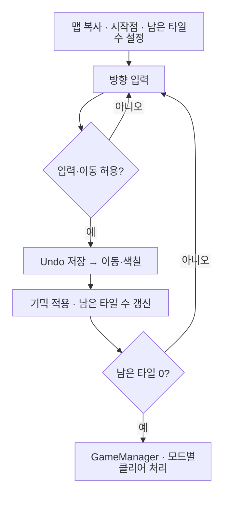
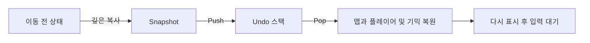

# 퍼즐 게임플레이 루프와 상태 복원

담당자 최성원 — 이동·타일 상태 처리, 기믹 연동, 게임 상태 복원

플레이어는 큐브 표면을 이동해 모든 길을 칠하면 퍼즐을 클리어합니다. 포탈이나 인버터가 이동 경로와 남은 타일을 바꿀 수 있으므로, 방향 입력에 따른 이동과 기믹 처리를 마친 뒤 클리어를 판정합니다. 되돌리기를 누르면 그 입력 전의 위치와 보드 상태가 함께 복원됩니다.

[입력 처리와 클리어 판정](#입력-처리와-클리어-판정) · [되돌리기](#한-입력을-되돌리는-상태-기록) · [인버터](#인버터의-타일-반전과-파동-연출) · [원본 코드와 예시 범위](#원본-코드와-예시-범위)

## 코드

### 입력 처리와 클리어 판정



`PuzzlePlayer`는 이동 전 상태를 저장하고, 도착 타일을 칠한 뒤 색칠 전의 타일 종류로 기믹을 실행합니다. 예를 들어 포탈에 들어가면 연결된 출구로 이동해 출구 칸까지 처리합니다. `GameManager`는 클리어 결과를 일반 스테이지, 유저 맵, 에디터 플레이 테스트에 맞게 전달합니다.

```csharp
// 입력 진입 예시: 나머지 5방향도 현재 카메라의 기준 벡터를 사용한다.
private async void Update()
{
    if (dAction.action.IsPressed())
        await MoveAndPaintAsync(Vector3Int.RoundToInt(currentRight));
}

// 원본의 방향별 래퍼 + MovePlayer + ApplyItem을 기본 경로 하나로 재구성
private async UniTask MoveAndPaintAsync(Vector3Int direction)
{
    if (isMoving || isCleared || !GameManager.Instance.isPlaying) return;
    Vector3Int next = playerPosition + direction;
    if (!IsOnSurface(next)) return;
    char tile = map[next.x, next.y, next.z];
    if (tile == (char)TileType.Empty || TileHelper.IsPainted(tile)) return;

    // 이동 연출이 끝날 때까지 추가 입력이 같은 상태를 동시에 바꾸지 못하게 한다.
    isMoving = true;
    try
    {
        SaveUndoState();
        await playerModel.DOMove(next, playerMoveDuration)
            .AsyncWaitForCompletion().AsUniTask();
        playerPosition = next;

        // 색칠 전의 타일 종류로 도착한 기믹을 판정한다.
        Paint(next);
        if (tile == (char)TileType.PortalIn)
        {
            Vector3Int exit = portals[next];
            playerPosition = exit;
            playerModel.position = exit;
            Paint(exit);
        }
        else if (tile == (char)TileType.Inv)
        {
            await ApplyInverterAsync(next);
        }

        // 인버터가 남은 타일 수를 바꿀 수 있으므로 기믹 완료 뒤에 판정한다.
        CheckGameCleared();
    }
    finally
    {
        // 기믹 처리에서 예외가 나도 이동 잠금 자체는 해제한다.
        isMoving = false;
    }
}

// 타일을 색칠 상태로 바꾸고 남은 길 개수와 표시를 함께 갱신
private void Paint(Vector3Int p)
{
    char before = map[p.x, p.y, p.z];
    if (TileHelper.IsPainted(before)) return;
    map[p.x, p.y, p.z] = TileHelper.PaintTable[before];
    --roadLeftCount;
    tiles[p.x, p.y, p.z].SimpleRender(map[p.x, p.y, p.z]);
}

// 퍼즐 판정과 모드별 후처리를 분리: 수동 테스트 성공은 에디터에도 전달
private void CheckGameCleared()
{
    if (roadLeftCount != 0 || isCleared) return;
    isCleared = true;
    if (_isTesting)
    {
        MapEditor.Instance.SetValidated(true, _answer);
        GameManager.Instance.GameClearedTest(_moves);
    }
    else if (_isSingle)
        GameManager.Instance.GameClearedSingle(_moves);
    else if (_isUser)
        GameManager.Instance.GameClearedUser(_moves).Forget();
}
```

### 한 입력을 되돌리는 상태 기록

포탈을 통과한 입력을 취소하면 이전 위치, 타일 색칠 상태, 남은 길 수가 함께 복원되어야 합니다. `SaveUndoState()`는 이동 전 보드와 포탈 연결을 복사해 스택에 넣고, 고스트 잔여 횟수와 레이저 보유 여부도 기록합니다. `Undo()`는 마지막 기록으로 돌아갑니다.



```csharp
private readonly Stack<(
    char[,,] Map, Vector3Int Position, int Roads, int Ghost, bool Laser,
    Dictionary<Vector3Int, Vector3Int> Portals)> undo = new();

// 유효한 이동을 확정한 시점에 변경 전 상태를 깊은 복사로 보관
private void SaveUndoState()
{
    undo.Push(((char[,,])map.Clone(), playerPosition, roadLeftCount,
        currentGhostCount, hasLaser,
        new Dictionary<Vector3Int, Vector3Int>(portals)));
}

// 최근 이동 취소: 데이터 복원 후 그 상태로 전체 타일 다시 표시
public void Undo()
{
    if (undo.Count == 0 || isMoving || isCleared
        || !GameManager.Instance.isPlaying) return;
    var previous = undo.Pop();
    map = previous.Map;
    playerPosition = previous.Position;
    playerModel.position = playerPosition;
    roadLeftCount = previous.Roads;
    currentGhostCount = previous.Ghost;
    hasLaser = previous.Laser;
    portals = previous.Portals;
    Render();
}
```

### 인버터의 타일 반전과 파동 연출

인버터는 발동 칸을 제외한 표면 타일의 색칠 상태를 바꾸고, 미도색 타일 수를 새로 셉니다. 화면에서는 발동 위치에서 가까운 타일부터 차례로 바뀌도록 표시해 반전이 어디서 시작됐는지 알 수 있게 합니다.

```csharp
// 인버터: 데이터는 즉시 반전, 연출은 맨해튼 거리별로 순차 재생
private async UniTask ApplyInverterAsync(Vector3Int origin)
{
    var waves = new SortedDictionary<int, List<Vector3Int>>();
    // 반전 뒤 남은 길 수는 이전 값과 달라지므로 새 상태에서 다시 센다.
    roadLeftCount = 0;
    int size = map.GetLength(0);

    for (int x = 0; x < size; ++x)
    for (int y = 0; y < size; ++y)
    for (int z = 0; z < size; ++z)
    {
        var p = new Vector3Int(x, y, z);
        if (!IsOnSurface(p) || p == origin
            || map[x, y, z] == (char)TileType.Empty) continue;

        int distance = Mathf.Abs(x - origin.x) + Mathf.Abs(y - origin.y)
            + Mathf.Abs(z - origin.z);
        if (!waves.TryGetValue(distance, out var group))
            waves[distance] = group = new List<Vector3Int>();
        group.Add(p);

        map[x, y, z] = TileHelper.InvTable[map[x, y, z]];
        if (!TileHelper.IsPainted(map[x, y, z])) ++roadLeftCount;
    }

    var animations = new List<UniTask>();
    // SortedDictionary의 거리 오름차순으로 가까운 타일부터 연출한다.
    foreach (var group in waves.Values)
    {
        foreach (var p in group)
        {
            tiles[p.x, p.y, p.z].SimpleRender(map[p.x, p.y, p.z]);
            animations.Add(tiles[p.x, p.y, p.z].Pop(false));
        }
        await UniTask.Delay(TimeSpan.FromSeconds(waveInterval));
    }
    await UniTask.WhenAll(animations);
}
```

## 원본 코드와 예시 범위

- 기준 커밋은 [`6688273`](https://github.com/1Seong/Capstone2/commit/66882730c36e4c3f4e7d59f019a835ea749f39b8)입니다. 원본은 [MovePlayer](https://github.com/1Seong/Capstone2/blob/66882730c36e4c3f4e7d59f019a835ea749f39b8/Assets/Scripts/PuzzlePlayer.cs#L539), [SaveUndoState](https://github.com/1Seong/Capstone2/blob/66882730c36e4c3f4e7d59f019a835ea749f39b8/Assets/Scripts/PuzzlePlayer.cs#L1089), [InverterEffectAsync](https://github.com/1Seong/Capstone2/blob/66882730c36e4c3f4e7d59f019a835ea749f39b8/Assets/Scripts/PuzzlePlayer.cs#L688)에서 확인할 수 있습니다.
- 이동 예시는 D 방향과 기본 이동·포탈·인버터 경로를 중심으로 재구성했습니다. 이동 횟수와 해답 미리보기 경로는 원본의 `_moves`와 `_answer`에서 관리합니다.
- 되돌리기 예시는 원본의 상태 구조체를 튜플로 풀어 썼습니다. 인버터 예시는 거리 그룹 구성과 타일 반전을 한 번의 순회로 표현했습니다.
- [고스트·레이저·대시](../gimmick-state/README.md)와 [레이어 회전](../layer-rotation/README.md)은 별도 예시에서 이어집니다.
