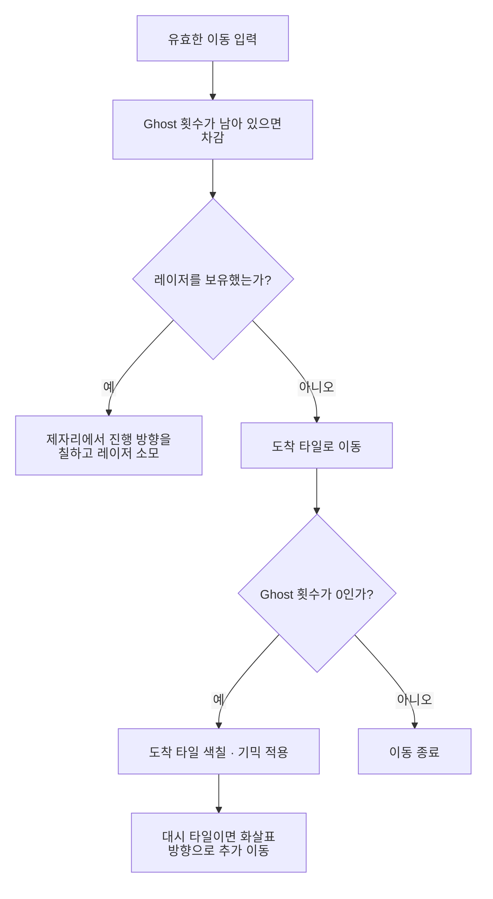

# Ghost·레이저·대시의 상태와 연속 이동

담당자 최성원 — 퍼즐 기믹과 이동 상태 연동

Ghost를 얻으면 일정 횟수 동안 이미 칠한 길을 다시 밟을 수 있습니다. 레이저는 제자리에서 입력한 방향으로 길을 칠하고, 대시는 타일의 화살표 방향으로 이동을 한 번 더 시도합니다.

[기믹 적용 순서](#이동-입력에-기믹을-적용하는-순서) · [원본 코드와 예시 범위](#원본-코드와-예시-범위)

## 코드

### 이동 입력에 기믹을 적용하는 순서

`PuzzlePlayer`는 이동할 수 있는 방향인지 확인한 뒤 Ghost 횟수와 레이저 보유 상태를 확인합니다. 예를 들어 Ghost 횟수가 1인 상태에서 이동하면 먼저 0으로 줄어들고, 도착 타일부터 다시 색칠과 기믹 처리가 적용됩니다. 도착 타일이 대시라면 추가 이동까지 최초 입력의 되돌리기 한 번에 묶입니다.



```csharp
// ApplyItem에서 Ghost·레이저 획득과 +X 대시를 발췌
private async UniTask ApplySpecialTile(char before)
{
    switch (before)
    {
        case (char)TileType.Ghost:
            CurrentGhostCount = TileHelper.GhostCount;
            break;
        case (char)TileType.Laser:
            HasLaser = true;
            break;
        case (char)TileType.DashXp:
            // false를 전달해 연쇄 이동을 최초 입력의 Undo에 포함한다.
            await MovePlayer(Vector3.right, false);
            break;
    }
}

// MovePlayer의 일반 이동에서 Ghost 횟수에 따라 도착 타일을 처리한다.
private async UniTask ApplyGhostMove(Vector3 destination)
{
    if (_currentGhostCount > 0) --CurrentGhostCount;
    await playerModel.DOMove(destination, playerMoveDuration)
        .AsyncWaitForCompletion().AsUniTask();
    // 원본은 이동 전에 횟수를 차감하고, 차감 후 0이 되면 도착 타일을 처리한다.
    if (_currentGhostCount == 0)
    {
        int x = (int)destination.x, y = (int)destination.y, z = (int)destination.z;
        char before = _map[x, y, z];
        if (!TileHelper.IsPainted(before)) --_roadLeftCount;
        await PaintWithRender(x, y, z, true);
        await ApplyItem(x, y, z, before);
    }
}

// MovePlayer의 레이저 분기에서 진행 방향으로 이어진 타일을 색칠한다.
private async UniTask FireLaser(Vector3 next, Vector3 direction)
{
    HasLaser = false;
    var animations = new List<UniTask>();
    do
    {
        int x = (int)next.x, y = (int)next.y, z = (int)next.z;
        --_roadLeftCount;
        char after = TileHelper.InvTable[_map[x, y, z]];
        _map[x, y, z] = after;
        animations.Add(_tiles[x, y, z].Pop());
        _tiles[x, y, z].SimpleRender(after);
        await UniTask.WaitForSeconds(0.1f);
        next += direction;
    } while (!CannotMove((int)next.x, (int)next.y, (int)next.z));
    await UniTask.WhenAll(animations);
}
```

## 원본 코드와 예시 범위

- 기준 커밋 `6688273`의 [이동과 기믹 상태 처리](https://github.com/1Seong/Capstone2/blob/66882730c36e4c3f4e7d59f019a835ea749f39b8/Assets/Scripts/PuzzlePlayer.cs#L539)와 [타일별 기믹 적용](https://github.com/1Seong/Capstone2/blob/66882730c36e4c3f4e7d59f019a835ea749f39b8/Assets/Scripts/PuzzlePlayer.cs#L629)에서 이어 볼 수 있습니다.
- 이동 함수의 분기를 설명용 함수 세 개로 나눴습니다. `FireLaser`는 호출부에서 첫 타일의 이동 가능 여부를 확인한 뒤 실행하는 부분입니다. 대시는 +X만 발췌했으며 원본은 나머지 방향도 같은 방식으로 처리합니다.
- 입력 전 상태 복원과 인버터는 [게임플레이 예시](../gameplay/README.md), 회전 좌표 변환은 [레이어 회전 예시](../layer-rotation/README.md)에서 확인할 수 있습니다.
