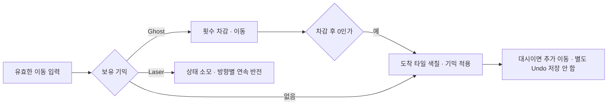

# Ghost·레이저·대시의 상태와 연속 이동

**담당자:** 최성원 — 퍼즐 기믹과 이동 상태 연동

## 코드

**PuzzlePlayer:** 획득한 기믹 상태를 다음 이동에 적용합니다. 이동 취소는 gameplay 샘플의 상태 스냅샷을 사용하며, 회전은 layer-rotation 샘플에 분리돼 있습니다.



```csharp
// ApplyItem의 상태 획득과 방향 대시를 대표로 발췌
private async UniTask ApplySpecialTile(char before)
{
    switch (before)
    {
        case (char)TileType.Ghost:
            CurrentGhostCount = TileHelper.GhostCount;
            break;
        case (char)TileType.Laser:
            HasLaser = true;
            break;
        case (char)TileType.DashXp:
            // false: 연쇄 이동을 별도 입력·별도 Undo 단위로 저장하지 않는다.
            await MovePlayer(Vector3.right, false);
            break;
    }
}

// MovePlayer의 Ghost 분기: 남은 횟수를 소모하고 색칠을 건너뛰는 구간
private async UniTask ApplyGhostMove(Vector3 destination)
{
    if (_currentGhostCount > 0) --CurrentGhostCount;
    await playerModel.DOMove(destination, playerMoveDuration)
        .AsyncWaitForCompletion().AsUniTask();
    // 원본은 이동 전에 횟수를 차감하고, 차감 후 0이 되면 도착 타일을 처리한다.
    if (_currentGhostCount == 0)
    {
        int x = (int)destination.x, y = (int)destination.y, z = (int)destination.z;
        char before = _map[x, y, z];
        if (!TileHelper.IsPainted(before)) --_roadLeftCount;
        await PaintWithRender(x, y, z, true);
        await ApplyItem(x, y, z, before);
    }
}

// MovePlayer의 레이저 분기: 한 번 사용하고 이동 방향의 타일을 연속 반전
private async UniTask FireLaser(Vector3 next, Vector3 direction)
{
    HasLaser = false;
    var animations = new List<UniTask>();
    do
    {
        int x = (int)next.x, y = (int)next.y, z = (int)next.z;
        --_roadLeftCount;
        char after = TileHelper.InvTable[_map[x, y, z]];
        _map[x, y, z] = after;
        animations.Add(_tiles[x, y, z].Pop());
        _tiles[x, y, z].SimpleRender(after);
        await UniTask.WaitForSeconds(0.1f);
        next += direction;
    } while (!CannotMove((int)next.x, (int)next.y, (int)next.z));
    await UniTask.WhenAll(animations);
}
```

## 생략 및 재구성한 내용

- 원본: Assets/Scripts/PuzzlePlayer.cs의 MovePlayer·ApplyItem. 기준 커밋: `66882730c36e4c3f4e7d59f019a835ea749f39b8`.
- 세 함수는 원본의 분기를 설명용으로 분리한 이름입니다. 이동 가능 여부·Undo 저장은 원본 MovePlayer에서 먼저 처리하며, 이 발췌의 FireLaser는 첫 도착 타일이 유효하다는 전제입니다.
- Ghost는 차감 후 횟수가 0인지 확인하는 원본 순서를 유지했습니다. 무제한 통과나 모든 기믹 무시를 뜻하지 않습니다.
- 대시는 +X만 대표로 남겼습니다. -X·±Y·±Z도 같은 방식으로 MovePlayer를 호출합니다. 포탈·인버터·회전과 입력 잠금은 별도 샘플에 있습니다.
- 렌더·필드·CurrentGhostCount/HasLaser 프로퍼티의 이펙트·카메라·사운드·CannotMove 본문은 생략했습니다. 원본 의존성이 필요한 설명용 코드이며 단독 실행되지 않습니다.
