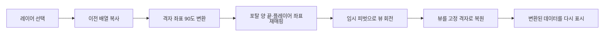

# 레이어 회전의 데이터·연출 분리

담당자 최성원 — 회전 좌표 변환, 포탈 좌표 갱신, 표시 오브젝트 복원

플레이어는 큐브의 한 층을 90도 돌려 끊긴 길을 연결할 수 있습니다. 포탈의 한쪽만 회전하는 층에 있다면 그쪽 좌표만 옮기고, 다른 쪽과의 연결은 유지해야 합니다. 같은 층에 있는 플레이어도 회전한 칸으로 이동합니다.

[격자 갱신과 회전 연출](#격자-갱신과-회전-연출) · [원본 코드와 예시 범위](#원본-코드와-예시-범위)

## 코드

### 격자 갱신과 회전 연출

`ApplyRotate`는 회전 전 타일을 복사한 뒤 정수 격자 좌표로 새 위치를 계산합니다. `RotateTilesEffect`는 타일 오브젝트를 임시 피벗에 붙여 회전시킵니다. 연출이 끝나면 각 오브젝트를 고정 격자에 되돌리고, 그 칸에 새로 배치된 타일을 그립니다. 이 구조로 여러 번 회전해도 연출에서 발생한 좌표 오차가 다음 퍼즐 상태에 누적되는 것을 막습니다.



```csharp
// X축 레이어만 발췌하며, 좌표 변환은 원본의 회전 규칙을 유지한다.
// 같은 X 레이어의 격자 좌표를 90도 회전한 데이터 좌표로 변환
private Vector3Int RotateX(Vector3Int p, bool clockwise)
{
    int max = map.GetLength(0) - 1;
    return clockwise
        ? new Vector3Int(p.x, max - p.z, p.y)
        : new Vector3Int(p.x, p.z, max - p.y);
}

// 레이어 배열·포탈·플레이어 좌표를 갱신한 뒤 회전 연출 실행
private async UniTask RotateLayerXAsync(int layer, bool clockwise)
{
    int size = map.GetLength(0);
    // 쓰기 순서와 관계없이 회전 전 타일을 읽는다.
    var before = (char[,,])map.Clone();
    var views = new List<PuzzleTile>();
    // 회전 대상 레이어 밖에 있는 플레이어의 논리 좌표는 유지한다.
    var playerTarget = playerPosition.x == layer
        ? RotateX(playerPosition, clockwise) : playerPosition;

    // 격자 좌표를 먼저 계산해 타일 데이터를 배치한다.
    for (int y = 0; y < size; ++y)
    for (int z = 0; z < size; ++z)
    {
        var source = new Vector3Int(layer, y, z);
        var target = RotateX(source, clockwise);
        map[target.x, target.y, target.z] = before[layer, y, z];
        views.Add(tiles[layer, y, z]);
    }

    // 포탈 양 끝을 일괄 변환해 갱신 중 키 충돌을 피한다.
    Vector3Int Remap(Vector3Int p)
        => p.x == layer ? RotateX(p, clockwise) : p;
    portals = portals.ToDictionary(pair => Remap(pair.Key), pair => Remap(pair.Value));
    playerPosition = playerTarget;

    await AnimateRotationAsync(views, clockwise ? 90f : -90f);
    playerModel.position = playerTarget;
}

// 임시 피벗으로 표시만 회전하고 원래 격자에 복원해 좌표 오차 누적 방지
private async UniTask AnimateRotationAsync(List<PuzzleTile> views, float angle)
{
    var pivot = new GameObject("RotationPivot");
    int max = map.GetLength(0) - 1;
    pivot.transform.position = Vector3.one * (max / 2f);
    // 타일 뷰는 고정 격자로 돌려놓고, 바뀐 내용만 다시 그리기 위한 복원 정보다.
    var originals = views.Select(tile => (
        tile, parent: tile.transform.parent,
        index: tile.transform.GetSiblingIndex(),
        position: tile.transform.localPosition)).ToList();

    foreach (var item in originals)
        item.tile.transform.SetParent(pivot.transform);
    await pivot.transform.DORotate(new Vector3(angle, 0, 0), 1.1f)
        .SetEase(Ease.OutBack).AsyncWaitForCompletion().AsUniTask();

    // 연출 후 표시 오브젝트를 고정 격자로 복원하고 변환된 데이터를 그린다.
    foreach (var item in originals)
    {
        item.tile.transform.SetParent(item.parent);
        item.tile.transform.SetSiblingIndex(item.index);
        item.tile.transform.localPosition = item.position;
        item.tile.transform.localRotation = Quaternion.identity;
        var p = Vector3Int.RoundToInt(item.tile.transform.position);
        item.tile.SimpleRender(map[p.x, p.y, p.z]);
    }
    UnityEngine.Object.Destroy(pivot);
}
```

## 원본 코드와 예시 범위

- 기준 커밋 `6688273`의 [격자와 포탈 좌표 갱신](https://github.com/1Seong/Capstone2/blob/66882730c36e4c3f4e7d59f019a835ea749f39b8/Assets/Scripts/PuzzlePlayer.cs#L749)과 [타일 회전 연출 및 복원](https://github.com/1Seong/Capstone2/blob/66882730c36e4c3f4e7d59f019a835ea749f39b8/Assets/Scripts/PuzzlePlayer.cs#L1031)에서 전체 흐름을 볼 수 있습니다.
- 예시는 X축 한 층을 대상으로 좌표를 일괄 계산해 포탈 사전을 재구성합니다. 원본은 회전 대상 층을 별도 배열에 복사하고 포탈 좌표를 순차적으로 갱신합니다. 원본에서 Y·Z축 회전과 연속 회전, 대시 방향이 회전에 맞춰 바뀌는 처리도 확인할 수 있습니다.
- 예시는 타일 연출 후 플레이어를 새 격자 위치에 배치하는 부분까지 보여줍니다. 플레이어와 내부 큐브의 애니메이션 및 사운드는 원본에 있습니다.
