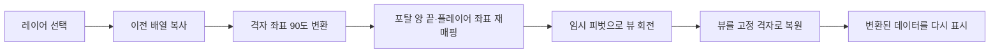

# 레이어 회전의 데이터·연출 분리

**담당자:** 최성원 — 회전 좌표 변환, 포탈 좌표 재매핑, 표시 오브젝트 복원

## 코드



**PuzzlePlayer.ApplyRotate:** 퍼즐 배열과 좌표를 갱신합니다. **RotateTilesEffect:** 회전 연출 후 표시 오브젝트를 원래 격자로 복원합니다. **PuzzleTile:** 변환된 상태를 다시 그립니다.

```csharp
// X축 레이어만 발췌하며, 좌표 변환은 원본의 회전 규칙을 유지한다.
// 같은 X 레이어의 격자 좌표를 90도 회전한 데이터 좌표로 변환
private Vector3Int RotateX(Vector3Int p, bool clockwise)
{
    int max = map.GetLength(0) - 1;
    return clockwise
        ? new Vector3Int(p.x, max - p.z, p.y)
        : new Vector3Int(p.x, p.z, max - p.y);
}

// 레이어 배열·포탈·플레이어 좌표를 갱신한 뒤 회전 연출 실행
private async UniTask RotateLayerXAsync(int layer, bool clockwise)
{
    int size = map.GetLength(0);
    // 읽기용 스냅샷을 분리해 앞서 쓴 회전 결과를 원본 타일로 읽지 않는다.
    var before = (char[,,])map.Clone();
    var views = new List<PuzzleTile>();
    // 회전 대상 레이어 밖에 있는 플레이어의 논리 좌표는 유지한다.
    var playerTarget = playerPosition.x == layer
        ? RotateX(playerPosition, clockwise) : playerPosition;

    // 데이터를 먼저 변환하고 Transform의 회전 결과로 좌표를 계산하지 않는다.
    for (int y = 0; y < size; ++y)
    for (int z = 0; z < size; ++z)
    {
        var source = new Vector3Int(layer, y, z);
        var target = RotateX(source, clockwise);
        map[target.x, target.y, target.z] = before[layer, y, z];
        views.Add(tiles[layer, y, z]);
    }

    // 포탈 양 끝을 일괄 변환해 갱신 중 키 충돌을 피한다.
    Vector3Int Remap(Vector3Int p)
        => p.x == layer ? RotateX(p, clockwise) : p;
    portals = portals.ToDictionary(pair => Remap(pair.Key), pair => Remap(pair.Value));
    playerPosition = playerTarget;

    await AnimateRotationAsync(views, clockwise ? 90f : -90f);
    playerModel.position = playerTarget;
}

// 임시 피벗으로 표시만 회전하고 원래 격자에 복원해 좌표 오차 누적 방지
private async UniTask AnimateRotationAsync(List<PuzzleTile> views, float angle)
{
    var pivot = new GameObject("RotationPivot");
    int max = map.GetLength(0) - 1;
    pivot.transform.position = Vector3.one * (max / 2f);
    // 타일 뷰는 고정 격자로 돌려놓고, 바뀐 내용만 다시 그리기 위한 복원 정보다.
    var originals = views.Select(tile => (
        tile, parent: tile.transform.parent,
        index: tile.transform.GetSiblingIndex(),
        position: tile.transform.localPosition)).ToList();

    foreach (var item in originals)
        item.tile.transform.SetParent(pivot.transform);
    await pivot.transform.DORotate(new Vector3(angle, 0, 0), 1.1f)
        .SetEase(Ease.OutBack).AsyncWaitForCompletion().AsUniTask();

    // 연출 후 표시 오브젝트를 고정 격자로 복원하고 변환된 데이터를 그린다.
    foreach (var item in originals)
    {
        item.tile.transform.SetParent(item.parent);
        item.tile.transform.SetSiblingIndex(item.index);
        item.tile.transform.localPosition = item.position;
        item.tile.transform.localRotation = Quaternion.identity;
        var p = Vector3Int.RoundToInt(item.tile.transform.position);
        item.tile.SimpleRender(map[p.x, p.y, p.z]);
    }
    UnityEngine.Object.Destroy(pivot);
}
```

## 생략 및 재구성한 내용

- 원본: `Assets/Scripts/PuzzlePlayer.cs`, `PuzzleTile.cs`. 기준 커밋: `66882730c36e4c3f4e7d59f019a835ea749f39b8`.
- X축 한 레이어만 남겼습니다. Y/Z축, 연속 레이어 전파, 대시 방향 재매핑과 회전 발동 조건은 제외했습니다. 
- 포탈은 순차적인 딕셔너리 수정 대신 양 끝 좌표를 일괄 재매핑하도록 재구성했습니다.
- 플레이어 회전 애니메이션·내부 큐브 연출·사운드·이펙트는 생략하고 플레이어를 데이터 좌표로 스냅합니다. 
- 필드 초기화·using·클래스 선언을 생략한 설명용 발췌입니다. Unity·UniTask·DOTween과 타일 뷰는 원본 의존성으로 단독 실행되지 않습니다.
