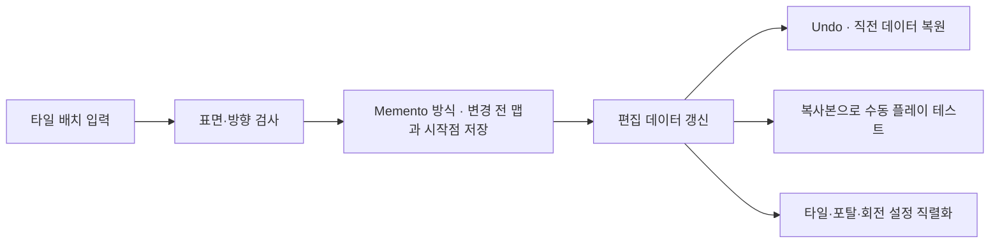

# 맵 에디터와 수동 플레이 테스트

**담당자:** 최성원 — 타일 배치, 편집 상태 되돌리기, 플레이 테스트·저장 흐름 구현

## 코드



**MapEditor:** 편집 데이터를 관리하고 테스트·저장으로 전달합니다. **EditTile:** 셀 클릭과 대시 배치 가능 여부를 검사합니다. **GameManager:** 편집 맵을 플레이 모드로 넘깁니다.

Undo는 맵·시작점 스냅샷을 복원하는 Memento 방식입니다. 테스트에는 별도 복사본을 넘겨 플레이 중 변경이 편집 원본에 역류하지 않도록 합니다.

```csharp
// MapEditor의 편집 상태와 EditTile의 배치 검사를 재구성한 발췌
private char[,,] map;
private Vector3Int? startPosition;
private Dictionary<Vector3Int, Vector3Int> portals;
private int rotationAxis;
private bool[] rotatableLayers;
private readonly Stack<(char[,,] map, Vector3Int? start)> undo = new();

// 배치·이동 대상이 범위 안의 큐브 겉면인지 검사
private bool IsOnSurface(Vector3Int p)
{
    int max = map.GetLength(0) - 1;
    return p.x >= 0 && p.x <= max && p.y >= 0 && p.y <= max
        && p.z >= 0 && p.z <= max
        && (p.x == 0 || p.x == max || p.y == 0 || p.y == max
            || p.z == 0 || p.z == max);
}

// 배치 전 상태 저장 → 기존 시작 위치 정리 → 선택한 타일 반영
public bool PlaceTile(Vector3Int p, char tile, Vector3Int? dashDirection = null)
{
    if (!IsOnSurface(p)) return false;
    // 대시가 큐브 바깥이나 내부를 향하면 해당 위치에 배치하지 않는다.
    if (dashDirection.HasValue && !IsOnSurface(p + dashDirection.Value))
        return false;

    // 배열 참조만 저장하면 다음 편집이 과거 기록까지 바꾸므로 값을 복사한다.
    undo.Push(((char[,,])map.Clone(), startPosition));
    if (tile == (char)TileType.Player)
    {
        // 시작 타일은 하나만 허용하므로 이전 위치를 먼저 비운다.
        if (startPosition.HasValue)
        {
            var old = startPosition.Value;
            map[old.x, old.y, old.z] = (char)TileType.Empty;
        }
        startPosition = p;
    }
    else if (startPosition.HasValue && startPosition.Value == p)
    {
        startPosition = null;
    }

    map[p.x, p.y, p.z] = tile;
    // 원본에서는 여기서 해당 셀의 SimpleRender와 시작 위치 모델을 갱신한다.
    return true;
}

// 가장 최근 편집을 취소하고 맵·시작 위치 복원
public bool Undo()
{
    if (undo.Count == 0) return false;
    (map, startPosition) = undo.Pop();
    // 복원한 데이터로 전체 타일과 시작 위치 모델을 다시 표시한다.
    return true;
}

// 편집 상태를 복사해 실제 게임 규칙으로 직접 플레이
public void PlayTest()
{
    if (!startPosition.HasValue)
        throw new InvalidOperationException("시작 위치가 필요합니다.");

    // 플레이 중 변경된 상태가 편집 데이터로 역류하지 않도록 복사한다.
    GameManager.Instance.PlayGame(
        (char[,,])map.Clone(),
        new Dictionary<Vector3Int, Vector3Int>(portals),
        rotationAxis,
        (bool[])rotatableLayers.Clone());
}

// 타일·포탈·회전 설정을 원본 데이터 포맷으로 직렬화해 초안 저장
public async Task SaveDraftAsync(MapCreating draft)
{
    draft.Data = StringHelper.Encode(map);
    // 타일 배열과 별개인 포탈 연결·회전 설정도 함께 저장해야 같은 맵을 복원한다.
    draft.PortalPairs = PortalPairHelper.Encode(PortalPairHelper.ToList(portals));
    draft.RotInfo = RotateHelper.Encode(new RotateInfo
        { Axis = rotationAxis, Layers = rotatableLayers });
    await DBManager.Instance.UpdateMapCreatingAsync(draft);
}
```

## 생략 및 재구성한 내용

- 원본: `Assets/Scripts/MapEditor.cs`, `EditTile.cs`. 기준 커밋: `66882730c36e4c3f4e7d59f019a835ea749f39b8`. 
- 서로 분산된 타일 배치·Undo·테스트·저장 메서드를 설명용으로 모았습니다.
- 포탈 생성·삭제와 회전 레이어 선택 UI는 제외했습니다. 
- 플레이 테스트 종료·수동 클리어 검증, 렌더링, 사운드, 씬 전환과 썸네일 캡처는 생략했습니다. 
- 저장 데이터의 `StringHelper`(큐브 문자열), `PortalPairHelper`(포탈 쌍 JSON), `RotateHelper`(회전 설정 JSON)는 에디터와 플레이가 같은 포맷을 공유하도록 하는 원본 헬퍼입니다. 
- `map`·시작 위치·포탈·회전 설정의 초기화와 `TileType`, `GameManager`, 직렬화 헬퍼·DB 모델은 프로젝트 의존성입니다. 클래스 선언·using을 생략한 발췌로 단독 실행되지 않습니다.
