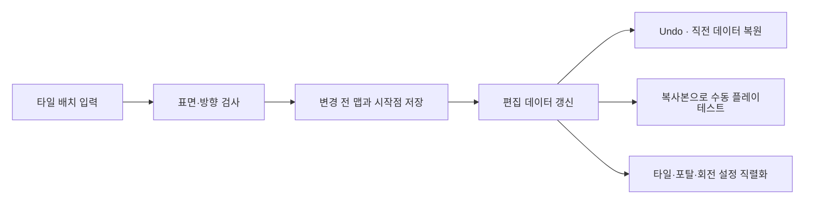

# 맵 에디터와 수동 플레이 테스트

담당자 최성원 — 타일 배치, 편집 상태 되돌리기, 플레이 테스트·저장 흐름 구현

맵 제작자는 큐브 표면에 타일을 배치하고, 방금 한 편집을 되돌리거나 만든 맵을 직접 플레이해 볼 수 있습니다. 플레이 테스트는 편집 보드를 복사해 진행하므로, 테스트를 마치고 돌아와도 편집 상태가 유지됩니다. 작업 중인 맵은 포탈 연결과 회전 설정을 포함해 초안으로 저장합니다.

[타일 배치부터 저장까지](#타일-배치에서-플레이-테스트와-저장까지) · [원본 코드와 예시 범위](#원본-코드와-예시-범위)

## 코드

### 타일 배치에서 플레이 테스트와 저장까지



`EditTile`은 클릭한 위치와 대시 방향을 검사합니다. 예를 들어 대시가 큐브 바깥으로 이어지는 위치에서는 배치를 막습니다. 유효한 입력이 들어오면 `MapEditor`가 변경 전 보드와 시작점을 기록하고 타일을 배치합니다.

되돌리기는 기록한 보드와 시작점을 복원합니다. 수동 테스트는 `GameManager`를 거쳐 플레이 모드로 들어가고, 클리어 결과는 에디터로 돌아옵니다. 저장할 때는 타일 배열, 포탈 쌍, 회전 축과 레이어를 각각 인코딩해 같은 맵을 다시 열 수 있게 합니다.

```csharp
// MapEditor의 편집 상태와 EditTile의 배치 검사를 재구성한 발췌
private char[,,] map;
private Vector3Int? startPosition;
private Dictionary<Vector3Int, Vector3Int> portals;
private int rotationAxis;
private bool[] rotatableLayers;
private readonly Stack<(char[,,] map, Vector3Int? start)> undo = new();

// 배치·이동 대상이 범위 안의 큐브 겉면인지 검사
private bool IsOnSurface(Vector3Int p)
{
    int max = map.GetLength(0) - 1;
    return p.x >= 0 && p.x <= max && p.y >= 0 && p.y <= max
        && p.z >= 0 && p.z <= max
        && (p.x == 0 || p.x == max || p.y == 0 || p.y == max
            || p.z == 0 || p.z == max);
}

// 배치 전 상태 저장 → 기존 시작 위치 정리 → 선택한 타일 반영
public bool PlaceTile(Vector3Int p, char tile, Vector3Int? dashDirection = null)
{
    if (!IsOnSurface(p)) return false;
    // 대시가 큐브 바깥이나 내부를 향하면 해당 위치에 배치하지 않는다.
    if (dashDirection.HasValue && !IsOnSurface(p + dashDirection.Value))
        return false;

    // 배열 참조만 저장하면 다음 편집이 과거 기록까지 바꾸므로 값을 복사한다.
    undo.Push(((char[,,])map.Clone(), startPosition));
    if (tile == (char)TileType.Player)
    {
        // 시작 타일은 하나만 허용하므로 이전 위치를 먼저 비운다.
        if (startPosition.HasValue)
        {
            var old = startPosition.Value;
            map[old.x, old.y, old.z] = (char)TileType.Empty;
        }
        startPosition = p;
    }
    else if (startPosition.HasValue && startPosition.Value == p)
    {
        startPosition = null;
    }

    map[p.x, p.y, p.z] = tile;
    // 원본에서는 여기서 해당 셀의 SimpleRender와 시작 위치 모델을 갱신한다.
    return true;
}

// 가장 최근 편집을 취소하고 맵·시작 위치 복원
public bool Undo()
{
    if (undo.Count == 0) return false;
    (map, startPosition) = undo.Pop();
    // 복원한 데이터로 전체 타일과 시작 위치 모델을 다시 표시한다.
    return true;
}

// 편집 상태를 복사해 실제 게임 규칙으로 직접 플레이
public void PlayTest()
{
    if (!startPosition.HasValue)
        throw new InvalidOperationException("시작 위치가 필요합니다.");

    // 플레이 중 변경된 상태가 편집 데이터로 역류하지 않도록 복사한다.
    GameManager.Instance.PlayGame(
        (char[,,])map.Clone(),
        new Dictionary<Vector3Int, Vector3Int>(portals),
        rotationAxis,
        (bool[])rotatableLayers.Clone());
}

// 타일·포탈·회전 설정을 원본 데이터 포맷으로 직렬화해 초안 저장
public async Task SaveDraftAsync(MapCreating draft)
{
    draft.Data = StringHelper.Encode(map);
    // 타일 배열과 별개인 포탈 연결·회전 설정도 함께 저장해야 같은 맵을 복원한다.
    draft.PortalPairs = PortalPairHelper.Encode(PortalPairHelper.ToList(portals));
    draft.RotInfo = RotateHelper.Encode(new RotateInfo
        { Axis = rotationAxis, Layers = rotatableLayers });
    await DBManager.Instance.UpdateMapCreatingAsync(draft);
}
```

## 원본 코드와 예시 범위

- 기준 커밋은 [`6688273`](https://github.com/1Seong/Capstone2/commit/66882730c36e4c3f4e7d59f019a835ea749f39b8)입니다. 원본 흐름은 [EditTile.OnMouseDown](https://github.com/1Seong/Capstone2/blob/66882730c36e4c3f4e7d59f019a835ea749f39b8/Assets/Scripts/EditTile.cs#L65), [MapEditor.SetTile](https://github.com/1Seong/Capstone2/blob/66882730c36e4c3f4e7d59f019a835ea749f39b8/Assets/Scripts/MapEditor.cs#L284), [MapEditor.PlayTest](https://github.com/1Seong/Capstone2/blob/66882730c36e4c3f4e7d59f019a835ea749f39b8/Assets/Scripts/MapEditor.cs#L374)에서 확인할 수 있습니다.
- 발췌에서는 타일 배치와 되돌리기를 단순화하고, 보드와 포탈 연결의 분리를 테스트 호출부 한 곳에 모았습니다. 원본은 보드를 `MapEditor.PlayTest()`에서 복사하고, 플레이용 포탈 연결은 `PuzzlePlayer.InitGame()`에서 구성합니다.
- 실제 초안 저장에는 썸네일 업로드와 오류 처리가 포함됩니다. 직렬화 형식은 [StringHelper.cs](https://github.com/1Seong/Capstone2/blob/66882730c36e4c3f4e7d59f019a835ea749f39b8/Assets/Scripts/StringHelper.cs), 저장 흐름은 [MapEditor.SaveToDB](https://github.com/1Seong/Capstone2/blob/66882730c36e4c3f4e7d59f019a835ea749f39b8/Assets/Scripts/MapEditor.cs#L535)에서 확인할 수 있습니다.
