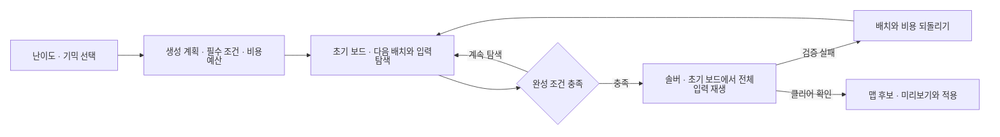

# 자동 맵 생성과 후보 검증

담당자 최성원 — 생성 조건과 비용 설계, 기믹 배치 탐색, 솔버 재생 검증과 에디터 적용

맵 제작자는 난이도와 사용할 기믹을 선택해 새 퍼즐 초안을 만들고, 후보를 미리 본 뒤 편집을 이어갈 수 있습니다. 생성기는 타일을 놓으면서 해답 입력도 함께 만들고, 그 입력으로 실제로 클리어되는 후보를 에디터에 전달합니다.

## 코드

`MapTools`는 난이도, 필수 기믹과 사용 순서를 생성 계획으로 변환합니다. `NewMapGenerator`는 큐브 표면에서 타일 배치와 해답 입력을 함께 탐색합니다. 한 번의 탐색에서 후보를 찾지 못하거나 한도에 도달하면 `GenerateWithRetries()`가 다른 시드로 재시도합니다.



예를 들어 앞서 발사한 레이저의 경로에 새 길을 추가하면, 그 길이 이전 발사에서 미리 칠해져 나중에 계획한 이동이 막힐 수 있습니다. `ReplayPrefix()`는 새 배치를 적용한 보드에서 처음부터 입력을 재생합니다. 기존 입력이 여전히 유효하고, 분기 지점의 위치·회전 상태·기믹 발동 순서가 유지되는지 확인합니다. [ReplayPrefix() 원본](https://github.com/1Seong/Capstone2/blob/55e95986068023ae72a0f2c57472254d38787d20/Assets/Scripts/MapCore/NewMapGenerator.cs#L824)

`NewMapGenerator.Explore()` / `PopFrame()`은 `Stack<SearchFrame>`으로 깊이 우선 탐색을 진행합니다. `TryDescend()`가 배치를 적용하고 입력을 시뮬레이션한 뒤 유효한 분기를 스택에 올립니다. 분기를 빠져나올 때는 타일 배치, 입력 목록과 소비 비용을 이전 상태로 복원합니다.

```csharp
private bool Explore(PuzzleSolver.Simulation root)
{
    var frames = new Stack<SearchFrame>();
    frames.Push(new SearchFrame(root, ExploreChoices(root).GetEnumerator()));
    try
    {
        while (frames.Count > 0 && !Stopped())
        {
            var frame = frames.Peek();
            if (frame.Choices.MoveNext())
            {
                var next = TryDescend(frame.Cursor, frame.Choices.Current);
                if (next != null) frames.Push(next);
                continue;
            }
            if (_candidate != null) return true;
            if (frames.Count > 1) _backtracks++;
            PopFrame(frames);
        }
        return false;
    }
    finally
    {
        while (frames.Count > 0) PopFrame(frames);
    }
}

private void PopFrame(Stack<SearchFrame> frames)
{
    var frame = frames.Pop();
    frame.Choices.Dispose();
    if (frames.Count > 0)
        UndoSearchChoice(frame.Placement, frames.Peek().Cursor, frame.PreviousInputCount, frame.Cost);
}
```

`NewMapGenerator.ExploreChoices()`는 목표 비용과 필수 조건을 충족한 배치를 확인합니다. 사용한 회전 레이어를 정리한 뒤 [퍼즐 솔버](../puzzle-solver/README.md)로 전체 입력을 재생합니다. 클리어와 필수 기믹 사용을 확인하면 초기 보드와 검증 결과를 `MapCandidate`에 담습니다. 에디터는 이 후보로 미리보기를 표시하고, 적용 버튼을 누르면 편집 중인 맵에 반영합니다.

```csharp
// ExploreChoices의 후보 확정 구간 발췌
if (Stopped()) yield break;
int orderProgress = OrderProgress(cursor);
if (_spent >= _target && cursor.Unpainted == 0 && cursor.GhostRemaining == 0 &&
    RequirementsMet(orderProgress) && _inputs.Count > 0)
{
    int axis = _placed[MapGimmick.Rotation] > 0 ? _rotationAxis : 0;
    var layers = axis == 0 ? null : RetainUsedRotationLayers();
    var witness = PuzzleSolver.VerifySequence(_board, _links, _inputs, axis, layers);
    if (Stopped()) yield break;
    if (witness.IsSolvable && (_plan.RequiredGimmicks & witness.UsedGimmicks) == _plan.RequiredGimmicks)
    {
        _candidate = new MapCandidate(MapDocument.FromBoard(_board, _links, axis, layers), witness,
            _spent, _attempts, _backtracks);
    }
    yield break;
}
```

## 생략 및 재구성한 내용

- 기준 커밋은 [`55e9598`](https://github.com/1Seong/Capstone2/commit/55e95986068023ae72a0f2c57472254d38787d20)입니다. 호출부와 탐색의 전체 흐름은 [MapTools.GenerateWithRetries](https://github.com/1Seong/Capstone2/blob/55e95986068023ae72a0f2c57472254d38787d20/Assets/Scripts/MapAssistBridge.cs#L36), [NewMapGenerator.Explore](https://github.com/1Seong/Capstone2/blob/55e95986068023ae72a0f2c57472254d38787d20/Assets/Scripts/MapCore/NewMapGenerator.cs#L263), [ExploreChoices](https://github.com/1Seong/Capstone2/blob/55e95986068023ae72a0f2c57472254d38787d20/Assets/Scripts/MapCore/NewMapGenerator.cs#L301)에서 확인할 수 있습니다.
- 코드 발췌는 탐색 스택과 후보 확정에 집중했습니다. 비용·가중치·한도와 포탈, 대시, 레이저, 고스트, 인버터, 회전의 배치 규칙은 [맵 생성 구현 문서](../../MapCore/README.md)에 있습니다.
- 후보 미리보기와 적용은 `MapEditor.RenderAssistPreview()`와 `ApplyAssistProposal()`에 있습니다. 고정 시드와 기믹 조합을 검사하는 방법은 [Unity 회귀 검사 안내](../../Tests/Unity/README.md)에 있습니다.
