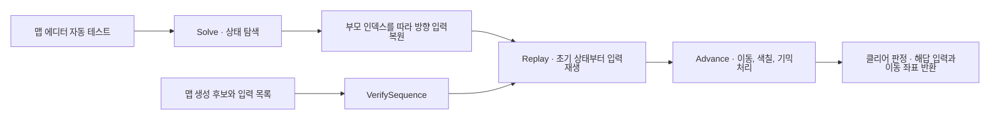

# 퍼즐 솔버와 해답 재생 검증

담당자 최성원 — 퍼즐 상태 탐색, 해답 복원, 맵 에디터 자동 검증 연동

맵 제작자는 자동 테스트로 자신이 만든 퍼즐의 클리어 경로를 찾고, 발견한 해답을 에디터에서 미리 볼 수 있습니다. 이동하면서 타일이 칠해지고 회전하면 보드 배치가 달라집니다. 같은 위치에 도착해도 그때까지의 진행에 따라 다음에 가능한 이동이 달라지므로, 솔버는 플레이어 위치와 함께 타일·포탈·기믹 상태를 추적합니다.

## 코드

`PuzzleSolver`는 보드, 포탈 연결, 회전 설정으로 초기 상태를 구성합니다. 에디터의 자동 테스트는 `Solve()`로 해답에 이르는 방향 입력을 찾습니다. 맵 생성기는 `VerifySequence()`로 이미 확보한 입력을 재생해 후보를 검증합니다.



`MapEditor.AutoTest()`는 편집 데이터의 복사본을 백그라운드 작업에 넘깁니다. 성공하면 `SolutionPath`를 에디터의 정답 미리보기에 연결합니다.

```csharp
// MapEditor.AutoTest 본문 발췌
var map = (char[,,])_map.Clone();
var portals = new Dictionary<Vector3Int, Vector3Int>(_portalPairDict);
var axis = _rotAxis;
var layers = (bool[])_canRotate.Clone();
using var cancellation = new CancellationTokenSource();
_autoTestCancellation = cancellation;

// 원본에서는 try 블록 안에서 실행한다.
var result = await Task.Run(() => PuzzleSolver.Solve(map, portals, axis, layers,
    cancellationToken: cancellation.Token), cancellation.Token);
if (cancellation.IsCancellationRequested)
    return;
if (!result.IsSolvable)
{
    PopUpManager.Instance.Show(result.ErrorMsg);
    return;
}

SetValidated(true, result.SolutionPath);
```

### 해답이 없는 분기 미리 버리기

`Search.Solve()`는 탐색을 시작하기 전에 칸 색(홀짝) 균형과, 시작 위치에서 모든 칸에 닿을 수 있는지를 확인합니다. 탐색 중에는 `Search.Explore()`가 상태를 펼치기 전에 `CannotFinish()`를 호출해 두 가지를 검사합니다. 칠할 칸이 끊겼는지 보는 연결성 검사와, 막다른 칸이 둘 이상인지 보는 끝점 검사입니다. 둘 중 하나라도 걸리면 그 분기 아래는 탐색하지 않습니다.

```csharp
// Search.Explore: 다음 상태를 펼치기 전에 해답이 없는 분기를 버린다
if (!trackGimmicks && CannotFinish(node.State))
    continue;
```

```csharp
// Search.CannotFinish 발췌: 현재 위치에서 칠하지 않은 칸만 따라 BFS
int reached = 1, leaves = 0, unpaintedReached = 0;
_queue[0] = state.Position;
_reached[state.Position] = ++_visit;
for (int i = 0; i < reached; i++)
{
    int cell = _queue[i];
    if (!TileHelper.IsPainted(tiles[cell]))
        unpaintedReached++;
    int degree = 0; // 이 칸에서 아직 이동할 수 있는 이웃 수
    for (int d = 0; d < Directions.Length; d++)
        if (Visit(_neighbors[cell, d]))
            degree++;
    // 끝점 검사: 들어가면 나올 수 없는 막다른 칸이 둘 이상이면 한 번에 모두 칠할 수 없다.
    // 포탈과 레이저는 칸을 건너뛰거나 멀리서 칠하므로, 있으면 이 검사를 하지 않는다.
    if (!portal && !laser && cell != state.Position && degree == 1 && ++leaves > 1)
        return true;
}
// 연결성 검사: 현재 위치에서 닿지 못한 칠할 칸이 남아 있으면 해답이 없다.
return unpaintedReached < state.Unpainted;
```

`Search.Explore()` / `BuildSolution()`은 방문 키로 중복 상태를 걸러냅니다. 키에는 표면의 타일 상태, 플레이어 위치, 보유한 기믹 상태가 포함됩니다. 회전 맵에서는 이후 이동에 영향을 줄 수 있는 포탈 연결 정보도 키에 들어갑니다. 해답을 복원하는 데 쓰는 `trace`는 부모 인덱스와 방향만 보관합니다.

아래 코드의 `required`는 검사할 기믹 목록입니다. `bypass`가 켜져 있으면 해당 기믹을 모두 사용하기 전에 클리어할 수 있는 우회 경로를 찾습니다. `Accepts()`는 클리어 상태가 현재 검사 조건을 충족하는지 판정합니다.

```csharp
// Search.Explore의 방향별 다음 상태 검사 발췌
children.Clear();
for (int d = 0; d < Directions.Length; d++)
{
    var next = Advance(node.State, d, trackGimmicks: trackGimmicks);
    if (next == null)
        continue;
    if (trackGimmicks)
        next.UsedGimmicks &= required;
    bool solved = next.Unpainted == 0;
    if (bypass && (next.UsedGimmicks & required) == required || solved && !Accepts(next))
        continue;
    if (!solved && (seen.Count >= budget || !seen.Add(Key(next))))
        continue;

    int traceIndex = trace.Count;
    trace.Add((node.TraceIndex, d));
    if (solved)
        return BuildSolution(trace, traceIndex, initial, explored);
    children.Add(new Node(next, traceIndex, d));
}

private SolveResult BuildSolution(List<(int parent, int direction)> trace, int traceIndex,
    State initial, int explored)
{
    var inputs = new Stack<int>();
    for (int i = traceIndex; i >= 0; i = trace[i].parent)
        inputs.Push(trace[i].direction);
    return Replay(initial, inputs, explored);
}
```

`Replay()`는 `Advance()`로 각 방향을 실행한 뒤 남은 미도색 칸 수와 실제 타일 상태를 검사합니다. 결과의 `SolutionInputs`는 재생할 방향이고, `SolutionPath`는 미리보기에 쓸 이동 좌표입니다. 대시나 포탈 때문에 입력 한 번에 여러 좌표가 기록될 수 있습니다. 탐색 한도에 도달한 경우 솔버는 판정이 유보되었다는 뜻의 `Inconclusive`를 반환합니다.

## 생략 및 재구성한 내용

- 기준 커밋은 [`55e9598`](https://github.com/1Seong/Capstone2/commit/55e95986068023ae72a0f2c57472254d38787d20)입니다. 원본은 [MapEditor.AutoTest](https://github.com/1Seong/Capstone2/blob/55e95986068023ae72a0f2c57472254d38787d20/Assets/Scripts/MapEditor.cs#L467), [PuzzleSolver.Search.Explore](https://github.com/1Seong/Capstone2/blob/55e95986068023ae72a0f2c57472254d38787d20/Assets/Scripts/PuzzleSolver.cs#L573), [Search.Replay](https://github.com/1Seong/Capstone2/blob/55e95986068023ae72a0f2c57472254d38787d20/Assets/Scripts/PuzzleSolver.cs#L793)에서 확인할 수 있습니다.
- 에디터 예시는 보드 복사와 결과 반영을 중심으로 발췌했습니다. 취소 및 예외 처리의 전체 흐름은 원본 `AutoTest()`에 있습니다.
- 솔버 예시는 방향별 다음 상태 검사와 부모 추적을 보여줍니다. 탐색 우선순위와 재시도는 `Search.Solve()`와 `Search.Explore()`에, 기믹별 상태 전이는 `Search.Advance()`에 있습니다.
- 가지치기 예시는 일반 격자 이웃만 남겼습니다. 회전 맵은 회전 후 닿는 이웃 목록(`_possibleNeighbors`)을 쓰고, 포탈 출구로 건너뛰는 처리, `Visit()` 본문, 고스트·인버터가 있으면 검사를 끄는 분기는 원본 [CannotFinish](https://github.com/1Seong/Capstone2/blob/55e95986068023ae72a0f2c57472254d38787d20/Assets/Scripts/PuzzleSolver.cs#L1074)에 있습니다. 호출 위치는 [Explore](https://github.com/1Seong/Capstone2/blob/55e95986068023ae72a0f2c57472254d38787d20/Assets/Scripts/PuzzleSolver.cs#L616)입니다.
- Unity에서 독립 풀이와 생성 후보의 입력 재생을 확인하는 방법은 [회귀 검사 안내](../../Tests/Unity/README.md)에 있습니다.

## 참고 문헌

- A. Itai, C. H. Papadimitriou, J. L. Szwarcfiter, "Hamilton Paths in Grid Graphs," *SIAM Journal on Computing*, vol. 11, no. 4, pp. 676–686, 1982. [PDF](https://csaws.cs.technion.ac.il/~itai/publications/Algorithms/Hamilton-paths.pdf)
  - 격자 그래프의 칸은 좌표 합의 홀짝으로 두 색으로 나뉘고, 해밀턴 경로가 있으려면 두 색의 칸 수가 경로의 시작 칸 색과 맞아야 합니다. 솔버는 이 조건을 3D 좌표(x+y+z)로 확장해, 회전과 기믹이 없는 맵 중 조건에 맞지 않는 맵을 탐색 전에 걸러냅니다. 원본은 [HasValidStartColor](https://github.com/1Seong/Capstone2/blob/55e95986068023ae72a0f2c57472254d38787d20/Assets/Scripts/PuzzleSolver.cs#L460)입니다.
  - 연결성 검사와 끝점 검사는 이 논문의 내용이 아니며, 위 [해답이 없는 분기 미리 버리기](#해답이-없는-분기-미리-버리기)에서 설명한 대로 솔버에서 따로 구현했습니다.
