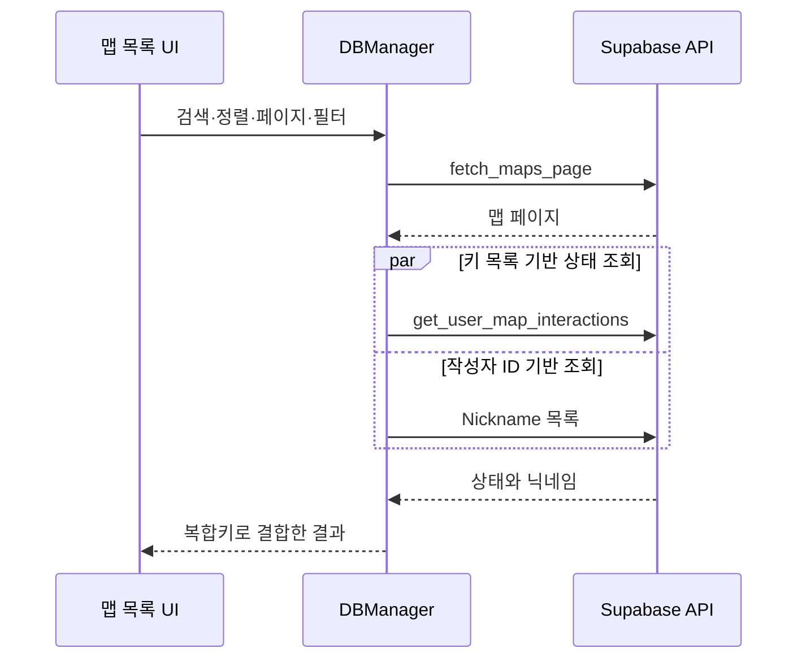

# UGC 맵 저장과 목록 조회

**담당자:** 최성원 — Supabase 데이터 API 연동, 검색·정렬·필터, 사용자별 맵 상태 조회

## 코드



**DBManager:** 맵과 사용자 상태를 조회·저장합니다. **UserLevelList:** 검색 조건과 좋아요·신고 입력을 받습니다. **LevelListController:** 작성 중인 맵과 업로드한 맵의 관리를 담당합니다. 아래는 UI 입력을 인자로 바꾼 데이터 처리 부분입니다.

```csharp
// DBManager 내부 발췌. client는 로그인된 Supabase.Client이다.
private const int PageSize = 18;

// 검색·정렬·클리어 필터로 한 페이지를 읽고, 사용자 상태와 작성자 이름 결합
public async Task<List<MapDetailResult>> FetchPageAsync(
    int page, string sortColumn, SortOrder order,
    string search, ClearFilter filter)
{
    if (page < 0) throw new ArgumentOutOfRangeException(nameof(page));
    if (sortColumn is not ("created_at" or "name" or "num_likes"))
        throw new ArgumentException("지원하지 않는 정렬 기준입니다.");

    string userId = client.Auth.CurrentUser.Id;
    // page는 0부터 시작하며 RPC의 끝 인덱스는 포함 범위로 전달한다.
    int from = page * PageSize;
    var parameters = new Dictionary<string, object>
    {
        ["p_user_id"] = userId,
        ["p_sort_col"] = sortColumn,
        ["p_sort_order"] = order == SortOrder.Ascending ? "ASC" : "DESC",
        ["p_from_idx"] = from.ToString(),
        ["p_to_idx"] = (from + PageSize - 1).ToString(),
        ["p_clear_filter"] = filter switch
        {
            ClearFilter.ClearedOnly => "cleared",
            ClearFilter.NotClearedOnly => "not_cleared",
            _ => "all"
        }
    };
    if (!string.IsNullOrWhiteSpace(search))
        parameters["p_search"] = search.Trim();

    // 검색·정렬·페이지 범위·클리어 필터를 하나의 RPC로 전달한다.
    var response = await client.Rpc("fetch_maps_page", parameters);
    var maps = ReadList<Map>(response.Content);
    if (maps.Count == 0) return new List<MapDetailResult>();

    // 맵 ID와 작성자 ID를 함께 써서 서로 다른 작성자의 맵을 구분한다.
    var mapKeys = maps.Select(m => new
        { map_id = m.MapId, map_user_id = m.UserId });
    var creatorIds = maps.Select(m => (object)m.UserId.ToString())
        .Distinct().ToList();

    // 맵마다 요청하지 않고, 페이지 전체의 상태와 작성자를 묶어 조회한다.
    var interactionsTask = client.Rpc("get_user_map_interactions",
        new Dictionary<string, object>
        {
            ["p_user_id"] = userId,
            ["p_map_keys"] = JArray.FromObject(mapKeys)
        });
    var nicknamesTask = client.From<Nickname>()
        .Filter("user_id", Postgrest.Constants.Operator.In, creatorIds).Get();
    // 서로 독립적인 두 배치 요청은 병렬로 기다린다.
    await Task.WhenAll(interactionsTask, nicknamesTask);

    var states = ReadList<MapInteractionResult>(interactionsTask.Result.Content)
        .ToDictionary(s => (s.MapId, s.MapUserId));
    var names = nicknamesTask.Result.Models.ToDictionary(n => n.UserId, n => n.Name);

    return maps.Select(map =>
    {
        // 좋아요·클리어 등의 사용자 기록이 없으면 아래에서 false로 표시한다.
        states.TryGetValue((map.MapId, map.UserId), out var state);
        return new MapDetailResult
        {
            Map = map,
            IsLiked = state?.IsLiked ?? false,
            IsCleared = state?.IsCleared ?? false,
            IsReported = state?.IsReported ?? false,
            Nickname = names.GetValueOrDefault(map.UserId, "익명")
        };
    }).ToList();
}

// 빈 응답을 빈 목록으로 처리하는 JSON 역직렬화 공통 함수
private static List<T> ReadList<T>(string json)
    => string.IsNullOrWhiteSpace(json)
        ? new List<T>()
        : JsonConvert.DeserializeObject<List<T>>(json) ?? new List<T>();
```

```csharp
// 원본 Postgrest 모델과 복합키를 그대로 사용한다.
// 개인 작업 목록에 새 맵 초안 생성
public async Task CreateDraftAsync()
    => await client.From<MapCreating>().Insert(new MapCreating
        { UserId = Guid.Parse(client.Auth.CurrentUser.Id), Name = "New Puzzle" });

// 편집 중인 맵의 데이터·제목·설명 저장
public async Task UpdateDraftAsync(MapCreating draft)
    => await client.From<MapCreating>().Update(draft);

// 초안에서 만든 공개 맵을 등록하거나 같은 복합키의 맵 갱신
public async Task PublishAsync(Map map)
    => await client.From<Map>().Upsert(map,
        new QueryOptions { Returning = QueryOptions.ReturnType.Minimal });

// 이미 게시된 맵 정보 수정
public async Task UpdatePublishedAsync(Map map)
    => await client.From<Map>().Update(map);

// 해당 맵에 대한 현재 사용자의 좋아요 상태를 RPC로 전환
public async Task ToggleLikeAsync(long mapId, Guid creatorId)
    => await client.Rpc("toggle_map_like", new Dictionary<string, object>
    {
        ["p_map_id"] = mapId.ToString(),
        ["p_map_user_id"] = creatorId.ToString()
    });

// 신고 대상과 사유를 현재 사용자 정보와 함께 저장
public async Task ReportAsync(long mapId, Guid creatorId, string reason)
{
    if (string.IsNullOrWhiteSpace(reason))
        throw new ArgumentException("신고 내용이 필요합니다.");

    await client.From<Report>().Insert(new Report
    {
        UserId = Guid.Parse(client.Auth.CurrentUser.Id),
        MapId = mapId, MapUserId = creatorId, Desc = reason.Trim()
    });
}
```

## 생략 및 재구성한 내용

- 원본: `Assets/Scripts/DBManager.cs`, `LevelListController.cs`, `Assets/Scripts/UI/UserLevelList.cs`. 기준 커밋: `66882730c36e4c3f4e7d59f019a835ea749f39b8`.
- 상태 조회는 **키 목록 기반 배치**, 상태·닉네임 조회 사이에는 **병렬 처리**를 사용합니다. 전체 목록 조회가 한 요청으로 끝나는 것은 아닙니다.
- `Map`, `MapCreating`, `Report`, `Nickname`, 결과 모델·enum, SDK와 JSON 라이브러리는 원본 의존성입니다. 테이블 속성·복합키 정의, UI 셀·썸네일 로딩, 예외 팝업과 버튼 제어는 생략한 설명용 발췌입니다.
- 데이터 포맷 변환과 Storage 캡처·업로드는 에디터 원본에 있으며 여기서는 제외했습니다.
- RPC 구현·RLS 정책·DB 제약은 서버에 별도로 존재합니다.
