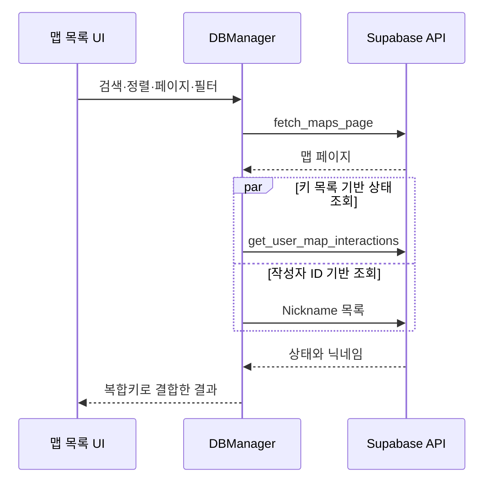
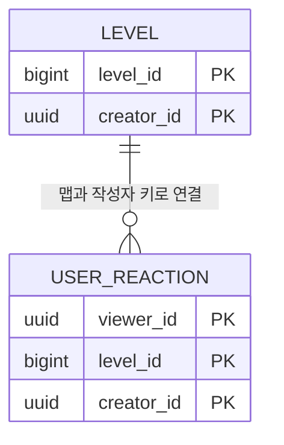

# UGC 맵 저장과 목록 조회

담당자 최성원 — Supabase 데이터 API 연동, 검색·정렬·필터, 사용자별 맵 상태 조회

플레이어는 자신이 만든 맵을 초안으로 저장했다가 게시하고, 다른 사람이 만든 맵을 검색할 수 있습니다. 예를 들어 미클리어 맵만 골라 좋아요 순으로 정렬하면 목록에 작성자와 내 클리어 여부가 함께 표시됩니다. 맵 목록과 사용자별 기록을 페이지 단위로 묶어 받아 이 화면을 구성했습니다.

[목록 조회](#페이지-단위-목록-조회) · [초안 저장과 게시](#초안-저장과-게시) · [서버 예시](#서버에서-소유자와-사용자-상태-확인) · [원본 코드와 예시 범위](#원본-코드와-예시-범위)

## 코드

### 페이지 단위 목록 조회



`UserLevelList`에서 넘긴 검색 조건으로 `DBManager`가 한 페이지에 최대 18개 맵을 조회합니다. 페이지가 돌아오면 맵들의 사용자별 상태와 작성자 닉네임을 두 배치 요청으로 병렬 조회합니다. 예를 들어 두 작성자가 모두 `map_id = 7`인 맵을 갖고 있어도, 맵 ID와 작성자 ID를 함께 사용해 각 맵의 좋아요와 클리어 상태를 구분합니다.

```csharp
// DBManager 내부 발췌. client는 로그인된 Supabase.Client이다.
private const int PageSize = 18;

// 검색·정렬·클리어 필터로 한 페이지를 읽고, 사용자 상태와 작성자 이름 결합
public async Task<List<MapDetailResult>> FetchPageAsync(
    int page, string sortColumn, SortOrder order,
    string search, ClearFilter filter)
{
    if (page < 0) throw new ArgumentOutOfRangeException(nameof(page));
    if (sortColumn is not ("created_at" or "name" or "num_likes"))
        throw new ArgumentException("지원하지 않는 정렬 기준입니다.");

    string userId = client.Auth.CurrentUser.Id;
    // page는 0부터 시작하며 RPC의 끝 인덱스는 포함 범위로 전달한다.
    int from = page * PageSize;
    var parameters = new Dictionary<string, object>
    {
        ["p_user_id"] = userId,
        ["p_sort_col"] = sortColumn,
        ["p_sort_order"] = order == SortOrder.Ascending ? "ASC" : "DESC",
        ["p_from_idx"] = from.ToString(),
        ["p_to_idx"] = (from + PageSize - 1).ToString(),
        ["p_clear_filter"] = filter switch
        {
            ClearFilter.ClearedOnly => "cleared",
            ClearFilter.NotClearedOnly => "not_cleared",
            _ => "all"
        }
    };
    if (!string.IsNullOrWhiteSpace(search))
        parameters["p_search"] = search.Trim();

    // 검색·정렬·페이지 범위·클리어 필터를 하나의 RPC로 전달한다.
    var response = await client.Rpc("fetch_maps_page", parameters);
    var maps = ReadList<Map>(response.Content);
    if (maps.Count == 0) return new List<MapDetailResult>();

    // 맵 ID와 작성자 ID를 함께 써서 서로 다른 작성자의 맵을 구분한다.
    var mapKeys = maps.Select(m => new
        { map_id = m.MapId, map_user_id = m.UserId });
    var creatorIds = maps.Select(m => (object)m.UserId.ToString())
        .Distinct().ToList();

    // 맵마다 요청하지 않고, 페이지 전체의 상태와 작성자를 묶어 조회한다.
    var interactionsTask = client.Rpc("get_user_map_interactions",
        new Dictionary<string, object>
        {
            ["p_user_id"] = userId,
            ["p_map_keys"] = JArray.FromObject(mapKeys)
        });
    var nicknamesTask = client.From<Nickname>()
        .Filter("user_id", Postgrest.Constants.Operator.In, creatorIds).Get();
    // 서로 독립적인 두 배치 요청은 병렬로 기다린다.
    await Task.WhenAll(interactionsTask, nicknamesTask);

    var states = ReadList<MapInteractionResult>(interactionsTask.Result.Content)
        .ToDictionary(s => (s.MapId, s.MapUserId));
    var names = nicknamesTask.Result.Models.ToDictionary(n => n.UserId, n => n.Name);

    return maps.Select(map =>
    {
        // 좋아요·클리어 등의 사용자 기록이 없으면 아래에서 false로 표시한다.
        states.TryGetValue((map.MapId, map.UserId), out var state);
        return new MapDetailResult
        {
            Map = map,
            IsLiked = state?.IsLiked ?? false,
            IsCleared = state?.IsCleared ?? false,
            IsReported = state?.IsReported ?? false,
            Nickname = names.GetValueOrDefault(map.UserId, "익명")
        };
    }).ToList();
}

// 빈 응답을 빈 목록으로 처리하는 JSON 역직렬화 공통 함수
private static List<T> ReadList<T>(string json)
    => string.IsNullOrWhiteSpace(json)
        ? new List<T>()
        : JsonConvert.DeserializeObject<List<T>>(json) ?? new List<T>();
```

### 초안 저장과 게시

`LevelListController`는 제작 중인 맵과 이미 올린 맵을 관리합니다. 게시할 때는 공개 맵의 복합키로 등록하거나 기존 게시본을 갱신합니다. 좋아요 전환과 신고는 화면에서 선택한 맵의 ID와 작성자 ID를 함께 넘깁니다.

```csharp
// 원본 Postgrest 모델과 복합키를 그대로 사용한다.
// 개인 작업 목록에 새 맵 초안 생성
public async Task CreateDraftAsync()
    => await client.From<MapCreating>().Insert(new MapCreating
        { UserId = Guid.Parse(client.Auth.CurrentUser.Id), Name = "New Puzzle" });

// 편집 중인 맵의 데이터·제목·설명 저장
public async Task UpdateDraftAsync(MapCreating draft)
    => await client.From<MapCreating>().Update(draft);

// 초안에서 만든 공개 맵을 등록하거나 같은 복합키의 맵 갱신
public async Task PublishAsync(Map map)
    => await client.From<Map>().Upsert(map,
        new QueryOptions { Returning = QueryOptions.ReturnType.Minimal });

// 이미 게시된 맵 정보 수정
public async Task UpdatePublishedAsync(Map map)
    => await client.From<Map>().Update(map);

// 해당 맵에 대한 현재 사용자의 좋아요 상태를 RPC로 전환
public async Task ToggleLikeAsync(long mapId, Guid creatorId)
    => await client.Rpc("toggle_map_like", new Dictionary<string, object>
    {
        ["p_map_id"] = mapId.ToString(),
        ["p_map_user_id"] = creatorId.ToString()
    });

// 신고 대상과 사유를 현재 사용자 정보와 함께 저장
public async Task ReportAsync(long mapId, Guid creatorId, string reason)
{
    if (string.IsNullOrWhiteSpace(reason))
        throw new ArgumentException("신고 내용이 필요합니다.");

    await client.From<Report>().Insert(new Report
    {
        UserId = Guid.Parse(client.Auth.CurrentUser.Id),
        MapId = mapId, MapUserId = creatorId, Desc = reason.Trim()
    });
}
```

### 서버에서 소유자와 사용자 상태 확인

아래 도식과 SQL은 2026-10-17에 확인한 서버 구조를 바탕으로 복합키, 소유자 검사, 배치 조회를 설명한 예시입니다. 도식과 SQL에서는 설명용 이름을 사용합니다.



수정 권한은 DB의 행 수준 보안 정책으로 제한합니다. 아래 예시의 `USING`은 로그인한 사용자가 수정하려는 행을 소유하는지, `WITH CHECK`는 수정된 행의 소유자가 여전히 그 사용자인지 검사합니다. [Supabase RLS 문서](https://supabase.com/docs/guides/database/postgres/row-level-security)

```sql
-- sample_levels와 정책 이름은 설명용 가칭이다.
CREATE POLICY "owner_update_example" ON sample_levels
  FOR UPDATE TO authenticated
  USING ((SELECT auth.uid()) = creator_id)
  WITH CHECK ((SELECT auth.uid()) = creator_id);
```

좋아요 조회 예시는 입력으로 받은 페이지의 맵 키에 현재 사용자의 좋아요 기록을 붙입니다. `LEFT JOIN`을 사용하면 좋아요 기록이 없는 맵도 결과에 남아 `false`로 표시됩니다. `:level_keys`는 맵 ID와 작성자 ID의 쌍을 담은 JSON 배열이고, 예시에서는 현재 사용자의 ID를 `auth.uid()`로 가져옵니다.

```sql
WITH keys AS (
  SELECT (elem->>'level_id')::bigint AS level_id,
         (elem->>'creator_id')::uuid AS creator_id
  FROM jsonb_array_elements(CAST(:level_keys AS jsonb)) AS elem
)
SELECT k.level_id, k.creator_id,
       reaction.viewer_id IS NOT NULL AS is_liked
FROM keys k
LEFT JOIN sample_reactions reaction
  ON reaction.level_id = k.level_id
  AND reaction.creator_id = k.creator_id
  AND reaction.viewer_id = (SELECT auth.uid());
```

당시 확인한 서버에서 정렬 기준은 허용 목록으로 제한했고, 좋아요 변경은 인증 토큰의 사용자 확인을 거쳤습니다.

## 원본 코드와 예시 범위

- 기준 커밋은 [`6688273`](https://github.com/1Seong/Capstone2/commit/66882730c36e4c3f4e7d59f019a835ea749f39b8)입니다. 목록 처리 원본은 [DBManager.FetchPageWithDetailsAsync](https://github.com/1Seong/Capstone2/blob/66882730c36e4c3f4e7d59f019a835ea749f39b8/Assets/Scripts/DBManager.cs#L271), [UserLevelList](https://github.com/1Seong/Capstone2/blob/66882730c36e4c3f4e7d59f019a835ea749f39b8/Assets/Scripts/UI/UserLevelList.cs), [LevelListController](https://github.com/1Seong/Capstone2/blob/66882730c36e4c3f4e7d59f019a835ea749f39b8/Assets/Scripts/LevelListController.cs)에서 확인할 수 있습니다.
- C# 예시는 UI 입력을 메서드 인자로 바꾸고, 페이지 조회와 결과 결합을 한 함수에 모았습니다. 썸네일 처리와 저장용 데이터 변환은 씬 컨트롤러와 에디터 원본에 있습니다.
